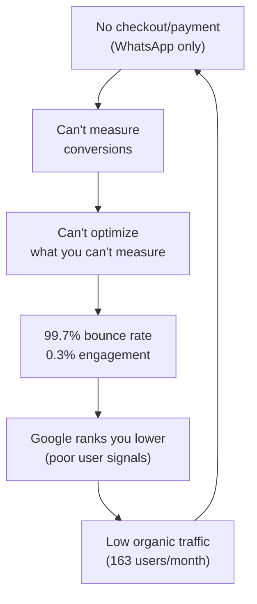
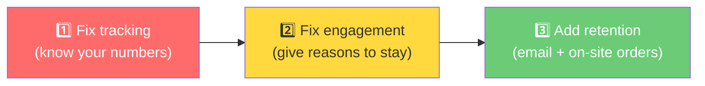

# Rose n Petals — Strategic Analysis & Unblock Plan

> Cross-referencing [overview-rnp.md](file:///Users/hirensharma/Documents/rnp/HERMES/overview-rnp.md) (technical/business model) with [rnp-website-audit.md](file:///Users/hirensharma/Documents/rnp/HERMES/rnp-website-audit.md) (performance/marketing data).

---

## 1. WHY YOU'RE STUCK

The data from both documents reveals a **vicious cycle** with three interlocking root causes:

### 🔁 The Stuck Loop



### Root Cause 1: **The WhatsApp-Only Checkout is a Dead End**
Your entire conversion funnel exits the website at the critical moment. The overview confirms there's *"no actual order processing/payment integration (only WhatsApp initiation)"*. This means:
- You **cannot track conversions** (the audit shows 0% measurable conversion rate)
- Visitors who don't want to WhatsApp a stranger have **no alternative path to buy**
- Google sees every WhatsApp click as a **bounce** (user left the site), destroying your engagement metrics
- You have **zero data** on what products people want but didn't buy

### Root Cause 2: **The Website is a Catalog, Not a Store**
The overview describes a technically functional MVP, but the audit data proves the experience isn't compelling enough:

| Signal | Data Point | What It Means |
|--------|-----------|---------------|
| 99.7% bounce rate | Audit line 34 | People glance and leave — no reason to stay |
| 0% returning visitors | 100% new users | Nobody finds enough value to come back |
| 2.0 pages/session | Audit line 36 | Homepage → Catalog → Leave. No deeper journey |
| 0% lander engagement | Audit line 99 | Landing page template vars (`{{PAGE_TITLE}}`) may be rendering raw |
| 61s avg session | Audit line 35 | Quick scan, not shopping behavior |

### Root Cause 3: **Technical Infrastructure Can't Support Growth**
Even if you fix the UX, the overview reveals structural limitations:
- **In-memory product cache** — data lost on every Render restart
- **Google Sheets as database** — fine for 20 products, breaks at scale
- **No user accounts** — impossible to build retention features (wishlists, order history, loyalty)
- **No error monitoring** — you don't know when things break
- **`coupons.json` on filesystem** — resets on every deployment (Render's ephemeral filesystem)

> [!CAUTION]
> **Your coupons are likely being lost on every Render deploy.** Render uses an ephemeral filesystem — `coupons.json` is wiped each time the service spins down. This means any coupons created via the admin panel disappear silently.

---

## 2. IMMEDIATE BOTTLENECKS (Ranked by Impact)

### 🔴 #1 — The Conversion Black Hole
**Impact: Critical** | **Urgency: Immediate**

You have **no way to know if anyone is buying**. WhatsApp clicks aren't tracked as conversions in GA4. The [whatsapp-tracking.js](file:///Users/hirensharma/Documents/rnp/js/whatsapp-tracking.js) fires a `whatsapp_click` event, but it's not configured as a GA4 conversion event, and there's no follow-through tracking.

**Result:** You're flying completely blind on revenue.

---

### 🔴 #2 — The Landing Page is Broken
**Impact: High** | **Urgency: Immediate**

The [landing-page.html](file:///Users/hirensharma/Documents/rnp/landing-page.html) contains raw template variables (`{{PAGE_TITLE}}`, `{{META_DESCRIPTION}}`, `{{CANONICAL_URL}}`, `{{BREADCRUMB_SCHEMA}}`, `{{LOCAL_SCHEMA}}`). If the SSR route isn't properly replacing these, visitors from organic search land on a page showing `{{PAGE_TITLE}}` as the tab title — **0% engagement confirms this is likely happening**.

---

### 🔴 #3 — The Engagement Catastrophe
**Impact: High** | **Urgency: Week 1**

99.7% bounce rate isn't just bad UX — it's actively **hurting your Google rankings**. Google interprets this as "this page isn't useful for this query" and pushes you down. Your average position is already 3.8-6.2 for brand terms — it should be #1.

---

### 🟡 #4 — Zero Retention Infrastructure
**Impact: High** | **Urgency: Weeks 2-4**

100% new users means every customer acquisition dollar is spent once and never compounds. No email capture, no accounts, no push notifications, no remarketing pixels.

---

### 🟡 #5 — Fragile Data Layer
**Impact: Medium** | **Urgency: Weeks 2-4**

Google Sheets CSV → in-memory cache → lost on restart. Plus `coupons.json` is likely being wiped. You need persistent storage before adding any real e-commerce features.

---

## 3. SPECIFIC NEXT STEPS

### 📅 Week 1: Stop the Bleeding

#### Fix 1: Mark WhatsApp Clicks as GA4 Conversions
**WHY:** You need to know if anyone is converting. Right now, you literally have no revenue data.
**HOW:**
1. In GA4 Admin → Events → mark `whatsapp_click` as a conversion
2. Enhance [whatsapp-tracking.js](file:///Users/hirensharma/Documents/rnp/js/whatsapp-tracking.js) to include product name + price in event params
3. Add UTM params to WhatsApp links so you can track which page/product drove the click
```javascript
// Enhanced tracking — add to whatsapp-tracking.js
gtag('event', 'whatsapp_click', {
  event_category: 'Conversion',
  event_label: buttonLabel,
  value: parseFloat(link.dataset.price) || 0,
  currency: 'INR',
  item_name: link.dataset.productName || '',
  page_location: window.location.href
});
```

#### Fix 2: Fix the Landing Page Template Rendering
**WHY:** 0% engagement on `/lander` strongly suggests SSR isn't populating template variables.
**HOW:**
1. Check the SSR route in [server.js](file:///Users/hirensharma/Documents/rnp/server.js) that serves `/lander`
2. Verify all `{{VARIABLE}}` placeholders are being replaced server-side
3. Test with `curl https://rosenpetals.com/lander` to see raw HTML output

#### Fix 3: Fix URL Canonicalization
**WHY:** Homepage appears twice in analytics (`/` with 78 views and `/` with 48 views) — likely trailing slash or `www` vs non-`www` issues splitting your data and diluting SEO signals.
**HOW:**
1. Add a redirect middleware in [server.js](file:///Users/hirensharma/Documents/rnp/server.js):
```javascript
app.use((req, res, next) => {
  if (req.path !== '/' && req.path.endsWith('/')) {
    return res.redirect(301, req.path.slice(0, -1) + (req.url.includes('?') ? '?' + req.url.split('?')[1] : ''));
  }
  next();
});
```

#### Fix 4: Add Scroll & Engagement Tracking
**WHY:** GA4's default engagement tracking requires 10-second minimum session time AND a conversion event OR 2+ page views. With WhatsApp clicks bouncing users out, almost no sessions qualify as "engaged."
**HOW:**
```javascript
// Add to index.html — track meaningful interactions
gtag('event', 'scroll_depth', { percent: 25 }); // on 25% scroll
gtag('event', 'catalog_view', {}); // when catalog loads
gtag('event', 'product_detail_view', { item_name: productName });
```
Also configure GA4 Enhanced Measurement settings:
- Enable scroll tracking (90% scroll)
- Enable outbound click tracking
- Enable site search tracking

---

### 📅 Weeks 2-4: Build the Retention Engine

#### Initiative 1: Add Email Capture (Before Anything Else)
**WHY:** With 163 new users/month and 0% retention, you're leaking all of your traffic. Even capturing 10% of visitors' emails (16/month) gives you a direct channel to bring them back.
**HOW:**
- Add a **sticky footer banner** on homepage + catalog: *"Get ₹50 off your first bouquet — enter your email"*
- Use a free tier of Mailchimp/Brevo (Sendinblue) for the backend
- Store emails server-side via a simple `/api/subscribe` endpoint
- Create a 3-email welcome sequence: Welcome → Bestsellers → ₹50 coupon

#### Initiative 2: Add "Quick Order" Without Leaving the Site
**WHY:** Not everyone wants to open WhatsApp. A simple on-site order form reduces friction AND keeps users on your site (improving engagement metrics).
**HOW:**
- Add a modal/drawer on product pages: Name, Phone, Delivery Address, Preferred Time
- Submit to a new `/api/orders` endpoint → stores in a persistent database
- Auto-send a WhatsApp notification to your business number with order details
- Show a confirmation page (keeps the session alive, counts as engaged)

#### Initiative 3: Fix the Data Layer
**WHY:** `coupons.json` is being wiped on every deploy. In-memory cache means cold starts show no products until the CSV fetches.
**HOW:**
- **Quick:** Move coupon storage to a free Supabase/Neon PostgreSQL database
- **Quick:** Add a pre-start script to warm the product cache before the server accepts connections
- **Medium-term:** Consider moving product data from Google Sheets to a proper database

#### Initiative 4: Local SEO Blitz
**WHY:** "flower shop near me" (66 impressions, 3% CTR, position 4.8) is your highest-intent non-brand query. Moving from position 4.8 → 3 could double your clicks.
**HOW:**
- Create dedicated pages: `/flower-delivery-indirapuram`, `/flower-delivery-vaishali`, etc.
- Each page targets "[service] in [location]" with unique content
- Claim and optimize Google Business Profile with photos, hours, reviews
- Add `LocalBusiness` schema to every page (you have it on homepage, extend it)

---

### 📅 Months 2-3: Compound Growth

#### Strategy 1: Content Engine for Non-Brand Traffic
**WHY:** You only have ~15 queries driving traffic, almost all branded. Your blog ([blog-keep-fresh.html](file:///Users/hirensharma/Documents/rnp/blog-keep-fresh.html)) is a single static page — not a content engine.
**HOW:**
- Publish 2 blog posts/month targeting high-intent keywords:
  - "Best birthday flowers under ₹500 in Ghaziabad"
  - "Same day flower delivery Indirapuram — how it works"
  - "Flowers that last longest in Delhi NCR heat"
- Each post links to relevant catalog items → drives internal engagement
- Target the long-tail: your "lychee bouquet" query already gets 9.5% CTR

#### Strategy 2: Remarketing & Retargeting
**WHY:** You're paying (in time and effort) to get 163 visitors/month, then losing 100% of them forever.
**HOW:**
- Add Meta Pixel + Google Ads remarketing tag
- Create a "Visited catalog but didn't order" audience
- Run ₹200-500/day retargeting ads showing products they viewed
- Target seasonal moments: "You viewed roses last week — Valentine's is coming"

#### Strategy 3: Reviews & Social Proof
**WHY:** Your schema data shows no reviews. Adding reviews improves CTR from search results (star ratings in SERPs) and on-page conversion.
**HOW:**
- After each WhatsApp order, send a follow-up asking for a Google review
- Display reviews on product pages and homepage
- Add `AggregateRating` schema markup

---

## 4. STRATEGIC RECOMMENDATIONS

### Should you pivot, persevere, or adjust?

**Adjust the model — don't pivot.** Here's why:

The core business is **validated**: you've operated since 1999, you have a physical shop, brand recognition (your brand queries dominate your search traffic), and the "WhatsApp + 1-hour delivery" model works offline. The problem isn't the business — it's that **the website isn't pulling its weight** as a growth channel.

> [!IMPORTANT]
> **The website should be a lead generation machine, not a brochure.** Right now, it's an online catalog that people glance at and leave. Every page should have one job: get the visitor to take the next step (browse → view product → order/save/subscribe).

### Unique Advantages You're Not Leveraging

| Advantage | How to Leverage |
|-----------|----------------|
| **27 years in business (since 1999)** | Massive trust signal. Put "Trusted since 1999" everywhere. Use it in meta descriptions. Few online florists can claim this. |
| **Physical shop in Kavi Nagar** | Google Business Profile with photos, reviews, and "shop visit" tracking. Most online-only florists can't compete here. |
| **1-hour delivery** | This is your killer feature. Make it the #1 headline on every page. "Fresh flowers at your door in 60 minutes" beats every competitor. |
| **WhatsApp ordering (no app needed)** | Position this as a feature, not a limitation: "No login, no cart, no hassle — just message us." But add an on-site option for those who prefer it. |
| **AI referral traffic (7%)** | 12 sessions from ChatGPT is remarkable for a local business. Optimize for AI discoverability — structured data, clear FAQ content, authoritative pages. |

### The Single Biggest Opportunity

> [!TIP]
> **Fix the bounce rate.** Getting from 99.7% → 70% would mean going from **58 engaged sessions → ~54 engaged sessions out of 180** (wait — that's actually fewer). The real win: a lower bounce rate means Google **ranks you higher for more queries → more impressions → more traffic → more orders**. It's the single lever that compounds every other metric.
>
> Specifically: add a **compelling reason to stay on the page** (video of bouquet making, live "orders being delivered" counter, a "build your own bouquet" interactive tool). The current site is static content with no interaction hooks.

---

## 5. METRICS TO TRACK

### Leading Indicators (Weekly)

| Metric | Why It Matters | Tool |
|--------|---------------|------|
| **WhatsApp click rate** (clicks/visitors) | Direct revenue proxy until you have real checkout | GA4 Events |
| **Catalog → Product page rate** | Measures if catalog design is working | GA4 Funnel |
| **Scroll depth on homepage** | Shows if content above the fold is compelling | GA4 Enhanced |
| **Email capture rate** | Leading indicator of retention capability | Mailchimp/Custom |
| **Time to first interaction** | How fast users engage (or bounce) | GA4 |

### Lagging Indicators (Monthly)

| Metric | Current | 3-Month Target | 6-Month Target |
|--------|---------|----------------|----------------|
| Engaged sessions/month | 58 | 150+ | 400+ |
| Returning visitor % | 0% | 15% | 25% |
| WhatsApp clicks/month | Unknown | 30+ | 80+ |
| Organic non-brand clicks | ~5 | 25+ | 75+ |
| Email subscribers (cumulative) | 0 | 100+ | 400+ |
| Google Business Profile views | Unknown | Track baseline | 2x baseline |
| Average position (non-brand) | ~5.0 | 3.5 | 2.5 |

### Diagnostic Metrics (Check When Things Look Off)

| Metric | What It Diagnoses |
|--------|------------------|
| **Server cold start time** | Are products showing on first load? (in-memory cache issue) |
| **Coupon validation errors** | Is `coupons.json` being wiped on deploy? |
| **Lander page bounce rate** | Is the template rendering correctly? |
| **Mobile vs Desktop engagement** | Is the mobile experience broken? (likely majority traffic) |
| **Page speed (Core Web Vitals)** | LCP, FID, CLS scores affecting rankings |

---

## Summary: The 3 Things That Matter Most Right Now



Everything else is optimization on top of these three. Without tracking, you're guessing. Without engagement, traffic is wasted. Without retention, every customer is a one-time cost.

---

*Analysis based on live data from [overview-rnp.md](file:///Users/hirensharma/Documents/rnp/HERMES/overview-rnp.md) and [rnp-website-audit.md](file:///Users/hirensharma/Documents/rnp/HERMES/rnp-website-audit.md), cross-referenced with actual codebase inspection.*
